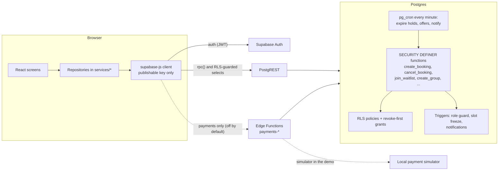

# Architecture

UniSport is a single-page React app on top of a Supabase project. **The
database is the authority**: the browser asks, the database decides, and the
UI shows only what the database answered. There is no application server of
its own; the only server-side code is Postgres (tables, policies, functions,
a cron job set) and, for payments, three Supabase Edge Functions.

## Pieces

| Piece | What it is | Where |
|---|---|---|
| Web app | React 19 + TypeScript, built with Vite, styled with Tailwind (compiled at build time, no CDN) | `App.tsx`, `components/`, `services/` |
| Auth | Supabase Auth (email + password). The role lives in `public.profiles`, never in browser storage | `services/authService.ts` |
| Data and rules | Postgres: tables, row-level security, `SECURITY DEFINER` functions, triggers | `supabase/migrations/` (40 files) |
| Scheduled work | `pg_cron`: expire holds, process the waitlist, notify offers about to lapse (each every minute) | migrations `20261010175700`, `20261010180300`, `20261028100000` |
| Payments (optional, off by default) | Three Edge Functions + a local simulator; Razorpay is never contacted in the demo | `supabase/functions/`, `supabase/payment-simulator/`, [PAYMENTS.md](PAYMENTS.md) |
| Tests | Vitest (unit and source-shape), pgTAP (database, including multi-session concurrency), Deno (Edge Functions, simulator) | [TESTING.md](TESTING.md) |

## Data flow

Reading the diagram: every arrow into Postgres is either a function call or a
row read that row-level security filters. The browser never writes a table
directly for anything that has a rule (bookings, waitlist, communities,
notifications, roles). Facility and slot management by owners is the one
place the client writes tables, and there RLS and column grants decide.

## Layers in the app

1. **Screens** (`components/`) render state and call handlers. They contain no
   business rules and never read local storage for data.
2. **Repositories** (`services/*Repository.ts`) are the only code that talks to
   Supabase. Each validates input, calls one function or query, maps the
   answer, and turns every failure into a typed error with a safe message.
   A malformed answer is a failure, never a success. There is no fallback to
   mock or cached data.
3. **Pure helpers** (`slotAvailability`, `routes`, `notificationText`,
   `bookingDate`, …) hold decisions that can be tested without a browser.
4. **Single-flight guards** (`services/singleFlight.ts`) make a double click
   or tap send one request.

## Routing

`services/routes.ts` is the route table: `/` (players), `/owner`, `/admin`,
`/community`, `/community/:groupId`, `/profile`, `/auth`; anything else is a
404 page. A wrong role is redirected to its own home; a signed-out deep link
shows sign-in and returns to the page afterwards. Guards are a convenience;
permissions are enforced by the database. The router honours
`VITE_BASE_PATH`, so the app can live under a sub-path.

## Time

The database's day is UTC (`current_date`). The date picker opens on the
later of the viewer's local date and the database's date, so it never opens
on a date the database would call past. Facility-local time zones are not
modelled (see the limitations in the README).

## Production build

`npm run build` produces static files with no third-party runtime dependency:
fonts, icons and photos are bundled, screens are split with `React.lazy`, and
`npm run guards:dist` fails if the output references a CDN. Deployment is a
static host with an SPA fallback plus a Supabase project; see
[DEPLOYMENT_RUNBOOK.md](DEPLOYMENT_RUNBOOK.md).
